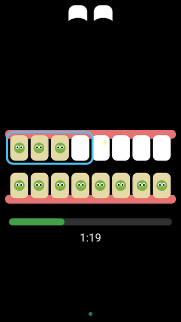
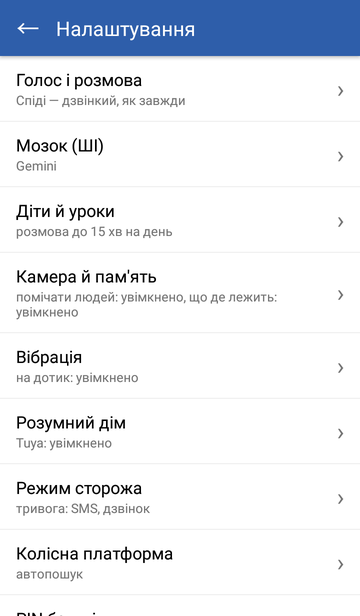
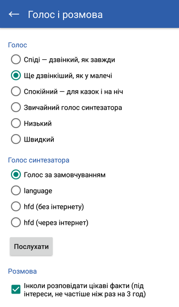
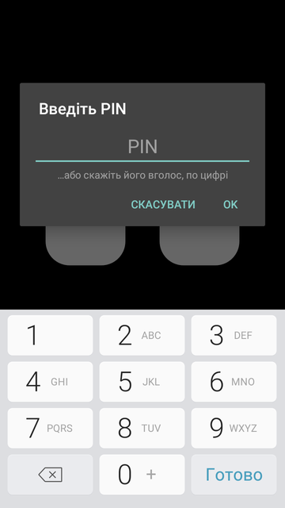
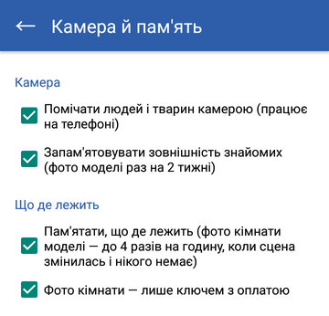
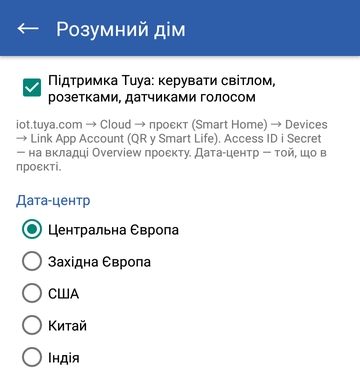
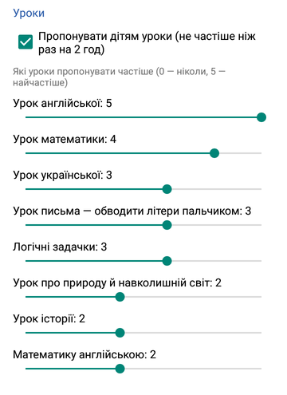

# Спіді — ШІ-помічниця з очима

<p align="center"></p>

Android-застосунок (цільова ОС **Android 7.1**, API 25): на повністю чорному екрані два білі
ока показують настрій. Спіді слухає голосові команди, що починаються з її імені, думає за
допомогою Claude або Gemini, відповідає голосом, дивиться обома камерами, слухає звук навколо,
проводить уроки для дитини, вартує дім і їздить на колісній платформі.

## Що вміє Спіді

Звертайся на ім'я — «Спіді, …» — або торкнись екрана. Найчастіше:

| Скажи | Що буде |
|---|---|
| «Спіді, я чищу зуби» | Дві хвилини по зонах із малюнком і казкою, зірочки й серія днів — [детальніше](#чищення-зубів) |
| «Знайди казку про кота пана Коцького» | Знайде повний текст в інтернеті й прочитає вголос — [детальніше](#казки-з-інтернету) |
| «Почитай книгу Кобзар» | Читає EPUB / FB2 / PDF / TXT з телефона, пам'ятає місце — [детальніше](#книги-вголос-без-моделі) |
| «Проведи урок математики» | Урок під вік і рівень дитини; урок письма — обвести пальцем — [детальніше](#уроки-для-дитини) |
| «Яка температура в приміщенні?» | Датчики розумного дому, навіть лише з Bluetooth — [детальніше](#розумний-дім-tuya) |
| «Спіді, вартуй» | Режим сторожа: фото, відео й звук у Telegram, пошту, SMS — [детальніше](#режим-сторожа) |
| «Нагадай через 30 хвилин вимкнути духовку» | Нагадування, будильник, таймер, календар |
| «Яка погода завтра?», «що нового в світі?» | Погода, новини, курс валют |
| Будь-що інше | Розмова з Claude чи Gemini: бачить камерами, чує, шукає в інтернеті |

<table>
<tr>
<td align="center"><br><sub>Чищення зубів: мікробики зникають<br>у міру чищення</sub></td>
<td align="center"><br><sub>Налаштування — за категоріями<br>(довге натискання на обличчя)</sub></td>
<td align="center"><br><sub>Голос Спіді — шість варіантів<br>і «Послухати»</sub></td>
</tr>
</table>

Коли Спіді довго шукає чи чекає (казку, датчик, оновлення), вона не мовчить: «Ще шукаю казку,
хвилинку…» — а за третім разом підкаже, що можна зупинити дотиком.

## Як це працює

```
мікрофон ─► VoiceListener ─► WakeWord("Спіді, …") ─► Assistant ─┬─► локальні розбори (…Commands, без моделі)
                                                                 └─► Brain ─► Claude / Gemini
                                                       │   ▲          (JSON: say + mood + action)
                                                       │   ├── CameraSnapshot (action = look, одна чи обидві камери)
                                                       │   ├── SoundClip (action = listen)
                                                       │   └── пошук (action = search)
                                                       ├─► FaceView (настрій очима, малюнки до уроків)
                                                       ├─► Speaker (TTS, укр., підвищений тон)
                                                       ├─► команди Спіді (action = command, білий список)
                                                       └─► RobotPlatform (action = move/stop)
```

| Модуль | Файл | Що робить |
|---|---|---|
| Обличчя | `face/FaceView.kt`, `face/Mood.kt` | Малює очі на Canvas. Кадри тільки під час анімацій; у спокої — 0 перемальовувань |
| Слух | `voice/VoiceListener.kt`, `voice/WakeWord.kt` | Безперервне розпізнавання `uk-UA`, виділення команди після «Спіді» |
| Голос | `voice/Speaker.kt` | Системний TTS, pitch/rate з конфігу |
| Мозок | `brain/*` | Історія розмови, системний промпт, клієнти Claude і Gemini через OkHttp |
| Зір | `vision/CameraSnapshot.kt` | Один кадр з задньої/фронтальної камери, після чого камера вимикається |
| Тіло | `robot/RobotPlatform.kt` | Інтерфейс платформи, Wi-Fi HTTP-реалізація, заготовка під USB |
| Сторож | `guard/*` | Рух і сторонні звуки обома камерами й мікрофоном, тривоги в Telegram / пошту / SMS / дзвінком |
| Школа | `school/*`, `face/TraceView.kt` | Уроки з моделлю (математика, логіка, світ, українська, історія), урок письма |
| Ініціатива | `initiative/*` | Нагадування, цікаві факти, пауза в розмові |
| Чищення зубів | `brushing/*`, `face/BrushView.kt` | Дві хвилини по зонах, мікробики на екрані, казка, зірочки |
| Казки | `books/Tales.kt` | Повний текст казки зі сторінок, які знайшов пошук моделі |
| Розумний дім | `home/*` | Tuya Cloud і Bluetooth-датчики Tuya напряму (`TuyaBle.kt`) |
| Дані | `data/SpeedyDb.kt` | Люди, обличчя, голоси, профілі, тварини — SQLite; решта — JSON у `files/` |

Модель завжди відповідає JSON:
```json
{"say": "Привіт!", "mood": "happy", "action": {"type": "none", "camera": "none", "direction": "none", "duration_ms": 0}, "remember": ""}
```
`look` — фото (`camera`: `forward`, `backward` чи `both`), `listen` — кілька секунд звуку навколо
(лише якщо там справді щось звучить; звук приймає лише Gemini), `search` — пошук; результат іде
моделі ще раз. `move` — крок платформи, `command` — команда Спіді з дозволеного переліку.

## Налаштування

1. Скопіюй `local.properties.example` у `local.properties` (моделі, голос, яскравість, ключ підпису).
2. Збери: `gradlew assembleDebug` (або ▶ в Android Studio / IntelliJ IDEA).
3. Встанови на телефон: `adb install -r app/build/outputs/apk/debug/app-debug.apk`.
4. Екран повертається за сенсором (усі 4 орієнтації).
5. На телефоні **довго натисни на обличчя** → PIN (віконце одразу з цифровою клавіатурою; можна й сказати
   вголос) → налаштування на весь екран, за категоріями: **Голос і розмова**, **Мозок (ШІ)** (ключ Claude
   або Gemini; для Gemini — до двох ключів і режим), **Діти й уроки**, **Камера й пам'ять**, **Вібрація**,
   **Розумний дім**, **Режим сторожа**, **Колісна платформа**, **PIN батьків**. Біля кожної — короткий
   підсумок; зміни зберігаються, коли повертаєшся стрілкою «←».

<table>
<tr>
<td align="center"><br><sub>PIN — одразу з цифровою клавіатурою</sub></td>
<td align="center"><br><sub>Категорії з підсумками</sub></td>
<td align="center"><br><sub>Голос: варіант, голос синтезатора,<br>«Послухати»</sub></td>
</tr>
</table>

API-ключі навмисно не вшиваються в APK: релізи публічні. Ключ зберігається лише на телефоні (у полях —
за крапками).

На телефоні потрібні: застосунок Google (розпізнавання мовлення), українські голосові дані
в «Налаштування → Мова та введення → Синтез мовлення», інтернет через Wi-Fi.

## Батьківський контроль

- **PIN налаштувань** (4 цифри, задається при першому запуску; зберігається лише хеш із сіллю):
  потрібен для налаштувань (довге натискання), а також для «дозволь читати сповіщення» /
  «дозволь керувати телефоном» (відкривають системні налаштування). **Змінити PIN** — кнопка в
  налаштуваннях або «Спіді, зміни пін-код» (спершу поточний, потім новий двічі). Поки на екрані
  віконце PIN, його можна **сказати вголос** по цифрі («два нуль чотири сім») — Спіді впише сама;
  фраза з PIN не потрапляє ні в команди, ні в журнал.
- **Хто дитина:** у налаштуваннях — галочки біля імен; голосом можна лише «це дитина»
  («я дорослий» не спрацює — щоб не обійти ліміт).
- **Денний ліміт розмов дитини** (за замовчуванням 15 хв, 0 — без обмеження): рахується час
  розмови (репліки з паузою ≤ 1 хв, уроки — повністю), окремо для кожної дитини; вичерпано —
  «Я так втомилася… Пограємо пізніше!» без моделі. У налаштуваннях видно, скільки використано
  сьогодні, і кнопка «Скинути ліміт» (скільки завгодно разів). Новий день — з нуля; а ще ліміт
  дитини скидається сам, якщо вона 4 години не зверталась до Спіді (прохання після вичерпання —
  теж звертання: 4 години рахуються від нього).

## Сповіщення й керування застосунками

Обидва доступи вмикає людина: «Спіді, дозволь читати сповіщення» / «…дозволь керувати телефоном»
(відкриває потрібні налаштування).
- **Сповіщення:** «що нового?», «хто писав?», «прочитай повідомлення» — локально, лише в пам'яті
  (останні 20). Нове повідомлення — коротко, без тексту: від людини — «Нове повідомлення у Viber від
  мами» (месенджери, SMS, пошта), від застосунку — «Нове повідомлення від Google: зараз 18°, Ужгород».
  Не частіше разу на хвилину, не вночі, банківські — ніколи вголос.
- **Керування** (служба спеціальних можливостей): коли відкрито інший застосунок — «натисни Пошук»,
  «прокрути вниз», «назад», «додому», «напиши "Привіт"», «що на екрані?», «повернись». Лише за
  прямою командою; у банківських/платіжних застосунках, менеджерах паролів, Дії, налаштуваннях і
  магазині застосунків — нічого не натискає й не вводить. Поки служба ввімкнена, Спіді слухає й у фоні.
- **Міні-Спіді:** поки відкрито інший застосунок, у кутку — маленька копія Спіді (дотик — повернутись,
  можна перетягнути). Відео не перекриває: стає під ним чи над ним; на весь екран — напівпрозора.
  Без служби спеціальних можливостей міні-Спіді немає, і у фоні Спіді не слухає. Samsung може вимкнути
  службу після оновлення застосунку — тоді знову «Спіді, дозволь керувати телефоном».

## Книги вголос (без моделі)

«Почитай книгу Кобзар», «почитай Гаррі Поттера», «які в тебе є книги?» — Спіді шукає файли EPUB, FB2
(і `.fb2.zip`), PDF і TXT (від 20 КБ) по всій пам'яті телефона й на картці, коли попросили (крім
`Android/data`, `DCIM`, прихованих і кеш-тек), назву зіставляє з іменем файлу й теки — і кирилицею,
і латиницею («Гаррі» ~ `Harry`), англійські назви — за звучанням приголосних («клін код» ~ `Clean_Code`,
«пітон» ~ `Python`, «джаваскрипт» ~ `JavaScript`). Спершу — серед уже прочитаних (`books.json`),
лише потім обхід сховища. Читає реченнями, місце зберігається перед кожним фрагментом
(`files/books.json`), тож після зупинки — з перерваного речення.
- **Зупинити** — торкнутися екрана (поки Спіді читає, мікрофон вимкнено). Нагадування й розряд
  ставлять читання на паузу.
- «Продовж читати» / «читай далі» (просто «продовжуй» — протягом 30 хв після читання), «яку книгу
  ми читаємо?», «читай з початку», «з початку розділу», «наступний / попередній розділ».
- Остання книга — своя в кожного, кого Спіді впізнала; місце в книзі — одне на книгу.
- **Мови:** українська, англійська, російська — голосом цієї мови (мова розділу — за його текстом,
  фрагмента — за ним самим: код англійською в російській книзі читається англійським голосом).
  Немає голосу мови в синтезаторі — читає українським і раз на книгу про це скаже (голоси —
  наприклад, у RHVoice).
- **PDF** — текстовий шар (pdfbox-android), «розділ» — сторінка: «наступна сторінка».
- **PDF-скани** (тексту немає) — розпізнавання офлайн: сторінку малює вбудований PdfRenderer
  (~300 dpi), текст — Tesseract (Tesseract4Android, однопотоковий: ядра лишаються синтезу мовлення).
  Словники `tessdata_fast` — українська, російська, англійська (~12 МБ разом, перевірка SHA-256) —
  завантажуються, коли вперше трапився скан; без інтернету — `adb push {ukr,rus,eng}.traineddata
  /sdcard/Android/data/com.speedy.assistant/files/`. Мова скану визначається на першій сторінці з
  текстом (усіма трьома словниками), далі — лише `eng`, `rus+eng` чи `ukr+eng` (терміни англійською).
  Наступна сторінка розпізнається, поки читається поточна; текст лишається в `files/ocr`, тож
  удруге книга читається без розпізнавання. Сторінки-малюнки (низька впевненість) пропускаються.
- Доступ до файлів: на Android 7–10 — дозвіл при запуску, на 11+ — «доступ до всіх файлів» (Спіді
  відкриє налаштування за PIN). Для дитини час читання йде в денний ліміт, як і уроки.
- **Переклад книги українською:** «читай українською» / «почитай книгу Clean Code українською»,
  назад — «читай в оригіналі». Англійські й російські фрагменти перекладаються офлайн (ML Kit),
  наступний — поки звучить поточний; код (дужки, `=`, `;`) не перекладається. Пам'ятається для книги.

## Казки з інтернету

«Знайди казку про кота пана Коцького», «почитай казку Колобок», «розкажи казочку Рукавичка» — спершу
серед книг на телефоні й уже знайдених казок (`files/kazky`), інакше Спіді шукає в інтернеті: модель
з пошуком дає адреси сторінок, а Спіді сама їх відкриває й бере **повний текст** казки (абзаци, діалоги,
пісеньки; меню, реклама й підписи сайту — геть). Читає як книгу: торкнутися — пауза, «продовжуй читати» —
далі. Повного тексту ніде немає — чесно скаже й розповість переказ моделі (його не зберігає, наступного
разу пошукає знову). «Розкажи казку» без назви — вигадає модель.

## Переклад (офлайн)

Google ML Kit, без інтернету й токенів після першого завантаження моделей (~30 МБ на мову);
українська ↔ англійська ↔ російська (російська → українська — через англійську).
- «Переклади на англійську я люблю каву», «як російською буде кіт» — фраза українською, переклад
  звучить голосом мови перекладу.
- «Переклади з англійської» / «…з російської» — «Кажи англійською», Спіді слухає фразу цією мовою
  (розпізнавач Google — потрібен інтернет) і перекладає українською; «…з англійської на російську».

## Фільми, аудіокниги, музика — у VLC

«Увімкни фільм Дюна», «постав аудіокнигу Кобзар», «увімкни мультик», «які є фільми?» — шукає відео
й аудіо тим самим обходом сховища, що й книги (аудіо від 300 КБ, відео від 3 МБ; без `DCIM`,
рингтонів, WhatsApp). Тека з кількома файлами — один запис по черзі (аудіокнига з розділів, серіал,
альбом), у природному порядку (`2.mp3` перед `10.mp3`). Грає VLC (немає — Спіді відкриє магазин).
Місце — у `files/media.json`.
- **Відео** — плеєр VLC з позицією; коли його закрили, VLC повертає позицію (документовані інтенти
  `org.videolan.vlc.player.result`): «Запам'ятала, де ми зупинились». Серію додивились — «наступна
  серія» (сама наступну не вмикає).
- **Аудіо** VLC грає у фоні, Спіді лишається на екрані. Позицію бачить у медіасесії VLC (потрібен
  доступ до сповіщень): перемотує на збережене місце, щокілька секунд його зберігає, а коли файл
  аудіокниги скінчився — вмикає наступний. Поки грає, мікрофон не слухає (там теж говорять):
  дотик — пауза й розмова, «продовжуй» — грає далі. «Пауза», «стоп», «продовж аудіокнигу».

## Нічний режим: хропіння (офлайн)

«Спіді, послухай уночі, чи я хроплю» (або «увімкни нічний режим», «…до шостої») — до 7:00 (чи
вказаної години) мікрофон слухає, а YAMNet (Google, Apache 2.0, `assets/yamnet.tflite`, клас 38
«Snoring») щопів секунди оцінює хропіння; у тиші модель не запускається. Хропіння — ритмічне:
епізод починається з 3 позитивних кадрів за 15 с і закінчується після 20 с тиші. Записуються лише
уривки з хропінням (5 с до початку, до 1 хв, не більше 40 за ніч) — WAV у
`Android/data/com.speedy.assistant/files/snoring/<дата>/`; звук нікуди не відправляється.
- Екран майже гасне, камера вимкнена, сповіщення й «бажання» мовчать; на «Спіді» не реагує
  (мікрофон зайнятий) — **вимкнути дотиком**.
- Вранці, вітаючись, Спіді каже підсумок: скільки разів і хвилин, найбільше між якими годинами,
  скільки уривків. «Чи я хропів?», «що ти чула вночі?» — підсумок будь-коли; «увімкни запис
  хропіння» — уривки у VLC.
- Щохвилини в журналі (тег `Night`): макс. оцінка хропіння й що ще було чути — для підлаштування порогу.

## Уроки англійської
«Спіді, проведи урок англійської» — урок (~6–8 хв) для того, кого Спіді бачить: у кожного свій
рівень (малюк / початківець / середній / впевнений) і прогрес (`files/english.json`).
- **Тема:** коротка теорія українською (англійські приклади — англійським голосом).
- **Повтори за мною:** фраза англійською й переклад; вимову Спіді **оцінює на слух** — за
  впевненістю англійського розпізнавача Google (0–100) і називає слово, над яким попрацювати.
- **Діалог:** питання англійською, відповідь своїми словами (зараховується за ключовими словами),
  інакше — зразок і «повтори».
- **Слова:** 2 нові й повторення за кривою забування (1, 2, 4, 8, 16, 32 дні).
- Тема зарахована при ≥ 60% — далі нова; поради підняти/знизити рівень за трьома уроками.
- 20 тем вбудовано (`assets/english/lessons.json`), словник ~160 слів; далі теми складає модель —
  один раз на рівень, з перевіркою шаблону, кеш у `files/english_units.json`.
- «як мій прогрес в англійській?», «мій рівень англійської — середній», на уроці — «досить», «повтори».
Потрібен інтернет (англійський розпізнавач — онлайн).

## Офлайн-слух і нагадування

- **Офлайн-слух (Vosk) — запасний:** вмикається сам, коли немає інтернету; з мережею слухає Google
  (вартовий вмикає його лише на мову). Модель `vosk-model-small-uk-v3-small` (Apache 2.0, 144 МБ):
  через Wi-Fi з alphacephei.com або вручну — `adb push <zip> /sdcard/Android/data/com.speedy.assistant/files/`;
  перевіряється за SHA-256. На Galaxy J5 вона повільна (4–10 с на фразу) і губить слова, тож лише як запас;
  модель `nano` була ще гіршою (не знала «спіді»). Займає ~0.5 ГБ пам'яті.
- **Нагадування** (без моделі): «нагадай о 18:00 подзвонити мамі», «нагадай через 20 хвилин…»,
  «нагадай завтра о 9…», «які в мене нагадування?», «скасуй нагадування». Спіді звертається на ім'я
  до того, хто просив; пропущені, поки застосунок був вимкнений (до 6 год), — при запуску.
- **Ранковий підсумок:** знайома людина вперше за день (5:00–12:00) — «Доброго ранку!», погода,
  календар і нагадування на сьогодні.

## Що Спіді знає про знайомих (локально)

Для кожного, кого Спіді знає на ім'я, — профіль у базі на телефоні (SQLite):
- **факти:** «я люблю каву», «мені не подобається дощ», «мій улюблений фільм …», «я працюю …»,
  «у мене є собака» — розбираються без моделі (коротке твердження — і відповідь без моделі);
  те, що модель помітила в розмові (поле `remember`), теж іде в профіль співрозмовника;
- **звички:** коли людина зазвичай поруч (вранці / вдень / ввечері), скільки разів бачились;
- **одяг:** колір верху за камерою, коли поруч одна знайома людина.

Модель отримує лише коротку довідку про співрозмовника (`[про співрозмовника: …]` у повідомленні,
не в системному промпті — кеш не скидається). «Що ти про мене знаєш?» — відповідь із профілю без
моделі; вітання згадує довгу відсутність чи новий колір одягу; «забудь мене» видаляє й профіль.

## Розмова

- **«Спіді» — лише на початку.** Після відповіді Спіді ще 45 с слухає без звертання (очі «слухаю»);
  кожна репліка продовжує розмову. Кінець — тиша або «дякую, все», «бувай», «на сьогодні все».
  Звертання можна й наприкінці: «А хто це там сидить, Спіді?».
- **Пауза в розмові.** Якщо після відповіді 20 с тиші (розпізнавач загубив фразу, пропав звук), Спіді
  ~хвилину кожні 9 с перевіряє, чи співрозмовник ще тут: записує 4 с звуку (YAMNet — чи там мовлення),
  передня камера бачить постійно, задня — через раз малим знімком без спалаху (детектор на телефоні).
  Чути мовлення й мозок — Gemini: звук іде моделі, і вона відповідає на сказане (або мовчить, якщо
  говорять не з нею). Людину видно двічі — одна коротка репліка в тему. Нікого — розмова тихо
  закінчується. Сама заговорює щонайбільше раз за паузу; модель — лише на підтвердження.
- **«Ось дивись», «послухай».** Модель може подивитися обома камерами одразу (телефон у руках —
  задня спрямована на предмет) і послухати звук поруч («що це за пісня?») — моделі звук надсилається,
  лише якщо там справді щось звучить.
- **«Забудь, що я люблю каву»** — Спіді прибирає це з пам'яті й профілю (модель уміє лише додавати).
- **Дитина й дорослий.** Модель знає, які діти вдома, і впізнає дитину за змістом слів (лічилки,
  дитяча вимова), навіть коли камера бачить дорослого. Голосом не розрізняємо — див. `CLAUDE.md`.
- **Швидкість:** відповідь потокова — Спіді говорить перше речення, поки модель дописує решту;
  з'єднання з «мозком» відкривається, щойно хтось заговорив. Затримка — у лозі (`затримка: …`).
- **Пошук в інтернеті:** модель сама вирішує (дія `search`) — Google Search (Gemini) / web search
  (Claude), запасний — українська Вікіпедія.
- **Курс валют (НБУ, без моделі):** «який курс євро?» — сьогоднішній; «як змінювався курс долара за
  тиждень / місяць / рік / 10 днів?» — з архіву НБУ: тоді й зараз, на скільки (гривні й відсотки),
  найвищий і найнижчий із датами (без періоду — за місяць).
- **Телефон (без моделі):** «відкрий YouTube», «будильник на 7:30», «таймер на 5 хвилин»,
  «який номер у Кості?», «подзвони мамі» (відкриває номеронабирач), «що в мене сьогодні в календарі?»,
  «запиши в календар лікаря на п'ятницю о 10» / «створи подію … 21 грудня» (у календар телефона —
  і в Google Календар, якщо синхронізований; без часу — на весь день; дозвіл — при першому записі).
- **Відео онлайн:** «увімкни на ютубі …» — YouTube, немає — NewPipe (чи форк Tubular), далі браузер;
  відео з телефона — VLC або інший плеєр; немає такого файлу — шукає онлайн тим самим шляхом.
  У NewPipe Спіді сама натискає перше відео (потрібна служба спеціальних можливостей); «Вміст
  недоступний» (часто дитячі відео YouTube) — наступне, після трьох — «Відкрити в браузері».
  «Увімкни друге / третє відео» — інше зі списку; «закрий відео» / «закрий NewPipe» — зупинити й
  повернутися. Відео скінчилось чи стоїть 30 с, а в застосунку ніхто нічого не робить, — Спіді сама
  зупиняє плеєр і повертається на екран.
- **Будильник:** голосом під сигнал майже не чути, тож вимикати — **дотиком до Спіді**: вона тисне
  «Відхилити» у вікні годинника Samsung (потрібна служба спеціальних можливостей).
- **Пам'ять:** модель записує факти про людей і дім («Тарас любить каву») у `files/memory.json`;
  вони додаються до системного промпту.

## Погода й місце (без моделі)

- «Спіді, яка погода?», «…завтра у Львові?», «чи буде дощ?» — прогноз з **Open-Meteo**
  (безкоштовно, без ключа, ~1 КБ, кеш 30 хв). Місто з фрази переводиться в називний
  відмінок (в Ужгороді → Ужгород), без міста — там, де телефон.
- **Якість повітря** (Open-Meteo, європейський індекс): у прогнозі — лише коли повітря погане;
  «яке повітря?» окремо — «Повітря чисте.» або рівень, пил PM2.5 і порада.
- «Спіді, де ми?» — GPS / Wi-Fi через системний LocationManager (без Play-сервісів).

## Що де лежить

Коли кімната помітно змінилась і завмерла (у кадрі нікого), Спіді тихо фотографує передньою камерою, а
модель перелічує речі й де вони («окуляри — на столі біля вікна»). Не частіше ніж 4 рази на годину; людей,
тварин і текст на екранах модель не описує; пам'ять — `files/things.json`, лише на телефоні, 30 днів.
- «Де мої окуляри?», «куди я поклала ключі?» — з пам'яті, без камери («востаннє бачила … сьогодні о 14:20»);
  не пам'ятає — запитання йде моделі (вона може подивитися).
- «Що змінилось у кімнаті?», «що де лежить?», «забудь, що де лежить».
- Модель отримує коротко `[речі в кімнаті: …]`.
- Налаштування: вимкнути зовсім; «фото кімнати — лише ключем з оплатою» (зняти галочку — з попередженням:
  безкоштовний ключ Gemini — Google може використовувати фото, їх можуть переглядати люди).

<p></p>

## Розумний дім (Tuya)

Світло, розетки, датчики, клімат і штори з Smart Life / Tuya Smart — через хмару Tuya (безкоштовний
обліковий запис розробника; ключі вводяться в налаштуваннях, підтримку там же вмикають).
- «Увімкни світло на кухні», «вимкни все світло», «вимкни чайник», «притуши світло в спальні»,
  «яскравість 30 відсотків», «закрий штори» — пристрій шукається за словами з назви в Smart Life
  («Лампа кухня») і видом («світло», «розетка»); кілька однаково підходять — «Яке саме: …?».
- «Яка температура в спальні?», «яка вологість вдома?», «яка зараз температура в приміщенні?» (усі
  датчики), «чи зачинене вікно на кухні?», «чи увімкнений обігрівач?», «що вдома?» — стан із хмари.
- **Датчики лише з Bluetooth** (без шлюзу — у Smart Life «не в мережі», напр. TH05): Спіді читає їх сама
  як шлюз — ключ і адресу бере з хмари, датчик шукає до 90 с (він рідко виходить в ефір), кожен
  озвучує, щойно прочитала; кого не видно — останні показники з хмари. Поки телефон зі Smart Life
  тримає датчик, Спіді його не бачить.
- Модель бачить пристрої (`[розумний дім: …]`) і може ними керувати. Замки, ворота, сигналізацію й
  обігрівачі за її проханням — лише з PIN батьків: з'являється віконце PIN на 20 секунд (можна сказати
  вголос); не ввели — нічого не відбувається. Прямою командою людини — без PIN.

<p></p>

## Новини

«Що нового в світі?», «які новини?» — короткий огляд через пошук моделі: важливе для міста, де
Спіді (лише місто, без адреси), для України й світу, і те, що цікавить співрозмовника за профілем.

## Цікаві факти

Коли поруч знайомий і давно не розмовляли, Спіді час від часу (не частіше ніж раз на 3 години на
людину) розповідає короткий факт — частіше з того, що людину цікавить, інколи з нової галузі.
Реакцію («цікаво», «нудно») запам'ятовує в профілі; розказане не повторює. Вимикається в налаштуваннях.

## Режим сторожа

«Спіді, вартуй» / «увімкни режим сторожа» — через 30 с (встигнути вийти) Спіді мовчки стежить:
камери по черзі (передня й задня, кожні 10 с — дві одночасно J5 не тримає) шукають рух і людей,
мікрофон — сторонні звуки (YAMNet: голоси, кроки, двері, скло, сигналізація). Знайомих людей і
тварин (кота вона вже знає) не вважає тривогою. Незнайоме — фото, відео 10 с чи запис звуку
(5 с до і 5 с після) у вибрані канали: **Telegram-бот**, **пошта (SMTP)**, **SMS**, **дзвінок**.
- Вимкнути — «досить вартувати» від знайомого обличчя в кадрі, інакше PIN.
- Налаштування — окрема категорія: канали, бот і пошук chat id, пауза між тривогами, пробна тривога.
- **Telegram:** створи бота в @BotFather → встав токен → напиши своєму боту «Почати» (/start) → «Знайти
  chat id» (впишеться число; ім'я бота в це поле не підходить) → «Надіслати пробну тривогу». Не
  знаходить — кнопка скаже чому (хибний токен, бот ще не отримав повідомлень, немає зв'язку).
- Модель може сторожа лише ввімкнути.

## Уроки для дитини

«Проведи урок математики», «давай логічні задачки», «урок про природу», «урок української»,
«урок історії», «математика англійською» («one plus one?») — завдання складає модель за віком,
рівнем (1–10) і прогресом учня (`files/school.json`); рівень росте від успішних уроків.
- **Українська:** букви й звуки, склади, рими, правопис, значення слів і вживання, вимова й наголос.
- **Малюнки:** до деяких завдань — прості ілюстрації на екрані (емодзі, фігури), очі тим часом
  меншають і піднімаються вгору.
- **Урок письма** (без моделі й інтернету): на екрані обрис фігури, цифри чи літери пунктиром —
  дитина обводить пальцем, обведене зафарбовується, внизу смужка прогресу. Рівні: фігури → цифри →
  великі → малі літери.
- **Для кого урок:** «навчи Тараса рахувати» — урок і прогрес записуються на того, кого назвали.
  Урок для дитини, а найближче обличчя — дорослого: відповідь не зараховується.
- **Спіді пропонує сама:** знайомій дитині час від часу — «Ліно, а давай позаймаємось? Можемо урок
  англійської — чи, може, урок письма?». Два види — випадково за вагами (0–5 для кожного,
  налаштування); урок письма не пропонує, коли стоїть на колісній платформі.

<p></p>

## Чищення зубів

«Спіді, я чищу зуби» (чи «давай почистимо зуби», «час чистити зуби») — дві хвилини, як радять
стоматологи, по 30 секунд на зону: верхні праворуч → верхні ліворуч → нижні ліворуч → нижні праворуч
(як у дзеркалі).

<p align="center"></p>

- **На екрані:** верхній і нижній ряд зубів; на непочищених сидять мікробики й зникають у міру чищення,
  почищені зуби біліють і блищать, поточна зона в рамці, внизу — смужка часу й відлік.
- **Казка, поки чистиш:** між підказками зон Спіді читає народну казку по реченню. Не дочитали —
  «Ой, а що ж було далі? Дізнаємось наступного разу!»; лишилось зовсім трохи — спитає, чи дочитати
  («так» — дочитає, «ні» — наступного разу). Щоразу нова казка: після чищення Спіді у фоні готує
  наступну (повний текст з інтернету), нові вибирає модель, повтор — лише в крайньому разі.
- **Зірочки:** одна за ранок (до 14:00) і одна за вечір; серія днів поспіль і особлива похвала за 3, 7,
  14, 30… днів. «Скільки в мене зірочок?» — підсумок. У кожної дитини свої (`files/brushing.json`).
- Зупинити — дотик; від 90 секунд чищення зірочка однаково зараховується.

## Функції Спіді для моделі

Шаблони фраз (книги, VLC, уроки, нагадування, календар, переклад, нічний режим, новини, сторож,
«знайди телефон») спрацьовують першими —
миттєво, офлайн, без токенів. Сказали інакше («поклич мене нагадуванням за пів години, щоб я вимкнув
духовку», «почитай ту книжку про програмування») — фраза йде до моделі, і та може відповісти дією
`command`: перекладає прохання в канонічну команду («нагадай через 30 хвилин вимкнути духовку»), а
Спіді виконує її тими самими розборами, що й голос. Дозволений перелік — без налаштувань, PIN,
доступів, віку, знайомств, оновлень, вимкнення сторожа й керування іншими застосунками; дитячий
ліміт діє як завжди. Опис форм у `Brain`, `runModelCommand` і `ModelCommandsTest` мусять збігатися.
Одна дія в схемі відповіді (і Claude, і Gemini) — тож нова функція з шаблоном фраз одразу доступна
й моделі (додати її форму в опис `command` у `Brain`).

## «Мозок»
- Крапка внизу екрана: зелена — на зв'язку, червона — не відповідає, жовта — немає ключа.
  Перевірка без токенів (список моделей): раз на 10 хв, після кожного запиту, після
  повернення мережі й зміни налаштувань.
- Gemini: якщо модель не відповідає (квота 429, 5xx, таймаут, 404), Спіді пробує інші
  моделі зі списку, доступного ключу (ListModels) — у кожної свої ліміти. Модель із
  вичерпаною квотою відпочиває 10 хв, перевантажена — 2 хв.
- **Два ключі Gemini** (з оплатою й безкоштовний — білінг у Google окремо для кожного проєкту) і
  режим у налаштуваннях: лише платний, лише безкоштовний, безкоштовний + платний як запас, платний +
  безкоштовний після ліміту. Ключ, що вичерпав квоту (чи досяг ліміту витрат), перевіряється знову за
  15 хв; не відповів — одразу інший. Галочка «фото й звук — лише платним ключем»: запити безкоштовного
  рівня Google може використовувати для навчання.

## Обличчя (локально)

Коли в кадрі людина, ML Kit (модель вбудована в APK) знаходить обличчя, а **MobileFaceNet**
(`assets/mobilefacenet.tflite`, MIT, з [syaringan357/Android-MobileFaceNet-MTCNN-FaceAntiSpoofing](https://github.com/syaringan357/Android-MobileFaceNet-MTCNN-FaceAntiSpoofing)
@ `d635649`, SHA-256 `d8ba40c0…443b`) перетворює його на відбиток із 192 чисел.
- незнайоме обличчя поруч — Спіді питає «Як тебе звати?» і запам'ятовує відповідь;
- знайоме — вітає на ім'я, а «великий мозок» отримує `[поруч: Тарас]`;
- «мене звати …», «забудь мене», «хто я?».

Відбитки зберігаються лише на телефоні (SQLite, `data/SpeedyDb`) і нікуди не надсилаються.

## Економія токенів і трафіку

- Модель за замовчуванням — **Claude Sonnet 5.5** (`claude.model` у `local.properties`), без
  «роздумів» (`thinking: between_tools`), effort `low`; Gemini — `thinkingBudget: 0`.
- Системний промпт і історія кешуються (`cache_control`): повтори в межах розмови ~0.1 ціни.
  Історія лише дописується; нова розмова — після 3 хв тиші або коли історія задовга.
- Фото для моделі — 768 px по довшій стороні (~560 токенів).
- Без моделі: стоп, оновлення, пошук платформи, «котра година», «скільки заряду».
- Скільки токенів пішло — у логах `ClaudeClient` / `GeminiClient` (`tokens: …`).

## Звуки

Спіді не говорить без потреби: голосом — лише у відповідь, а стан і бажання показує
короткими синтезованими сигналами (`voice/Chirps.kt`, без аудіофайлів):
- звернулися без команди — коротке «бі-іп» і чекає команду;
- хтось прийшов — радісний звук, котик чи собака — зацікавлений;
- пропала мережа / не відповідає «мозок» — три низькі сигнали; мережа повернулась — радісний;
- хоче на зарядку (нижче 20%, не частіше ніж раз на 15 хв) і хоче уваги (поруч хтось є,
  але з нею не говорили 20 хв; не частіше ніж раз на 30 хв, не з 22:00 до 8:00) — `Desires.kt`.

**Вартовий звуку** (`voice/SoundGate.kt`): у тиші Спіді сама слухає мікрофон за рівнем звуку —
без інтернету й без сигналів. Розпізнавач Google вмикається, лише коли хтось заговорив, і
слухає, поки говорять, + 8 с. Його сигнали йдуть потоком SYSTEM (на Galaxy J5), тож на час
сеансу гучність SYSTEM = 0 і потім відновлюється (рівень збережено й на диску). Якщо в
застосунку Google є офлайн-пакет української, розпізнавання йде без інтернету.

## Оновлення

Спіді перевіряє нову версію через 5 с після запуску і повідомляє, якщо вона є. Голосом:
- «Спіді, перевір оновлення» / «чи є оновлення» / «яка в тебе версія»
- «Спіді, оновись» / «онови застосунок» / «встанови оновлення» — завантажує APK, перевіряє
  SHA-256 і відкриває системний інсталятор (Android завжди просить підтвердити). Одразу після
  оголошення про нову версію досить сказати «оновись» — без імені.
- Завантаження (~45 МБ) на повільному Wi-Fi триває кілька хвилин: Спіді попереджає, каже «Ще завантажую
  оновлення…» (і «Половину завантажила», якщо качається довше 20 с), у журналі — МБ і швидкість. Майже
  стоїть (менше ~256 КБ за хвилину) — кидає й каже, що інтернет слабкий, а не лишається зайнятою.

На Android 7.1 треба один раз увімкнути «Налаштування → Безпека → Невідомі джерела». Після
встановлення Спіді сама повертається на екран (`update/RestartAfterUpdate`). На Galaxy J5 Play Маркет
падав під час перевірки встановлення і воно зависало; перемикача Play Protect у Play Маркеті замало —
на прохання власника вимкнено й системну перевірку (`package_verifier_enable 0`), і самооновлення
проходить голосом за ~16 с. Зависло — встановити через adb.

**Випуск версії:** збільш `versionCode` і `versionName` в `app/build.gradle.kts`, закоміть, потім
```powershell
.\release.ps1 -Notes "що нового"
```
(потрібен `GH_TOKEN`). Примітки Спіді читає вголос — коротко й природно.
Скрипт збирає підписаний APK, генерує `update.json` і публікує реліз на GitHub. Застосунок читає
`https://github.com/goropai/ai-assistant/releases/latest/download/update.json` (`speedy.updateManifestUrl`
у `gradle.properties`).

Ключ підпису (`signing.properties` у `local.properties`) підписує і debug, і release, тож оновлення
ставляться поверх версії з IDE. **Збережи його резервну копію** — без нього встановлений
застосунок не оновити.

## Присутність (локальна модель)

Фронтальна камера раз на ~1.5 с дає кадр 320×240 моделі **EfficientDet-Lite0** (TensorFlow Lite,
COCO, `app/src/main/assets`) — усе на телефоні, без інтернету й без витрат на API.
- очі **стежать** за людиною в кадрі;
- людина **прийшла** — Спіді прокидається, вітається і чекає команду без імені;
- **кіт чи собака** — «Ой, котик!» (вітання для кожного виду не частіше ніж раз на 10 хв);
- «великий мозок» отримує в кожному запиті, хто поруч (`[поруч: людина, кіт]`).

Під час розмови аналіз на паузі (камера потрібна для фото), нижче 15% заряду без зарядки —
вимкнено. Вимкнути зовсім: налаштування → «Помічати людей і тварин». Модель — Apache 2.0.

## Батарея

- Чорний фон (на OLED чорні пікселі не світяться), яскравість за замовчуванням 15% (`screen.brightness`).
- FaceView перемальовується тільки під час кліпання, зміни настрою чи мовлення.
- Локальна модель присутності — один кадр на ~1.5 с, пауза під час розмови й при низькому заряді.
- Камера вмикається лише на один кадр.
- Найбільший споживач зараз — постійна робота SpeechRecognizer (див. план).

## Протокол платформи (Wi-Fi)

Прошивка для ESP32-DevKitC + драйвер L9110S (шасі 4WD) і схема підключення — у [`firmware/`](firmware/README.md).

Мікроконтролер (наприклад, ESP32) у тій самій мережі приймає:
```
GET /move?dir=forward|backward|left|right&ms=0..3000&speed=0..100   (409 — перешкода попереду)
GET /stop
GET /status   -> {"distance_cm": 42, "moving": false, "last": "obstacle", ...}
```
Автопошук: UDP-порт 4210, запит `SPEEDY_DISCOVER`, відповідь `SPEEDY_ROBOT 80`.

**Навігація.** На завдання на кшталт «Спіді, під'їдь до кота» модель їде короткими кроками:
поїхала → новий кадр із камери спереду + відстань із датчика → вирішує наступний крок
(до 8 кроків). **Дотик до екрана під час руху — негайна зупинка** (мікрофон у цей час вимкнено).
Мотори має зупиняти сам контролер після `ms` — так платформа не поїде безконтрольно, якщо
зв'язок обірветься. Адреса задається в `robot.wifiUrl`.

## План

- [ ] Офлайн-детектор імені «Спіді» (Vosk з українською моделлю або Porcupine), щоб не тримати
      хмарний розпізнавач увімкненим постійно.
- [ ] Якісніший жіночий голос: хмарний TTS (Gemini TTS / Google Cloud TTS) з кешуванням фраз.
- [ ] USB-serial платформа (usb-serial-for-android), протокол `M <dir> <ms> <speed>\n`.
- [x] Цикл «подивись → поїдь → подивись» і датчик перешкод HC-SR04.
- [ ] Енкодери (LM393) для точних поворотів і відстані.
- [ ] Foreground service, автозапуск після завантаження телефона.
- [ ] Щітка Philips Sonicare For Kids (Bluetooth): чищення зубів стартує саме, казка — лише поки щітка
      працює, зараховується справжній час чищення.
